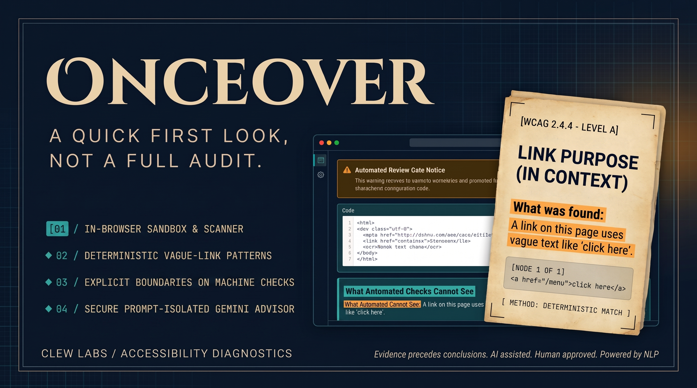

<div align="center">
  
</div>

# Onceover

> **Transparent, deterministic accessibility diagnostics paired with small-business plain-language guidance—built with zero compliance theater.**

[](#wcag-22-coverage-matrix)
[](https://github.com/dequelabs/axe-core)
[](#security--threat-model)
[](#architectural-boundaries-deterministic-scanner-vs-ai-advisor)

---

## Problem Statement

Small business owners—bakers, mechanics, florists, and boutique retailers—increasingly rely on their websites as the front door to their business. However, the web accessibility landscape presents them with two bad options:

1. **Incomprehensible Developer Jargon:** Existing tools like raw browser audits or enterprise compliance suites generate intimidating reports filled with CSS selectors, stack traces, and legal citations. Business owners without in-house engineering teams cannot understand or prioritize these findings.

2. **Deceptive "Compliance Theater" Overlays:** Predatory third-party plugins promise "one-line AI fixes" and guaranteed legal immunity. In reality, these overlays often disrupt screen readers, fail to fix underlying code flaws, and create false confidence while leaving businesses vulnerable to complaints and alienated customers.

3. **The Guarantee Trap:** No automated tool can certify an entire website as barrier-free. Yet, typical products either over-promise compliance or overwhelm users into inaction.

---

## The Solution: A Pragmatic "First Look"

**Onceover** provides a transparent, entry-level diagnostic scanner built from the ground up for the small shop owner:

* **Everyday Language, Not Legal Advice:** Replaces compliance jargon with clear, empathetic explanations of how an issue affects a customer trying to read a menu, fill out an order form, or navigate a site.

* **Strict Architectural Separation:** Scanning is 100% deterministic (using `axe-core` and custom heuristics inside an isolated sandbox). AI never guesses at code errors or assesses legal risk; it is strictly used to translate confirmed findings into plain-English next steps.

* **Radical Honesty & Blind Spot Disclosure:** Onceover requires an upfront Gate Notice and explicitly outlines what automated scanners cannot see—such as keyboard traps, audio sync, and reading flow—so business owners know where human review is still essential.

---

## Why It Matters & Business Impact

* **Welcoming Every Customer:** Over 15% of the global population lives with a disability. Inaccessible sites lock out local customers who want to support neighborhood businesses.

* **Demystifying Best Practices:** Accessibility is not about legal fear; it is about hospitality, good customer service, and solid web design. Onceover gives owners agency to improve their digital storefronts without expensive consultant retainers.

* **Ethical AI Implementation:** By isolating user code from the model and stripping compliance buzzwords through a strict lexicon filter, Onceover demonstrates how AI can empower non-technical users responsibly without feeding the overlay industry.

---

## Executive Summary

Web accessibility tools frequently suffer from two extremes: dense, opaque developer logs filled with raw DOM selectors that overwhelm local business owners, or predatory "AI overlay widgets" that promise instant legal immunity through automated script injections.

**Onceover** provides a principled third way: **a first-look diagnostic instrument designed specifically for small business owners** (bakeries, cafes, local retail, and independent service providers).

It combines:

1. **100% Deterministic Detection:** Real browser execution using `axe-core 4.14.0` alongside custom heuristic checks within an isolated, sandboxed DOM.
2. **Strict Prompt Isolation:** Zero raw user markup or DOM trees are transmitted to external LLMs. Only structured violation metadata (rule IDs, impacted element counts, and official WCAG references) is processed.
3. **Plain-Language Practical Remediation:** An empathetic translation engine converting technical syntax failures into concrete, non-punitive steps without legal jargon, certified stamps, or false compliance guarantees.

---

## Architectural Boundaries: Deterministic Scanner vs. AI Advisor

Onceover enforces an absolute separation of concerns between code evaluation and linguistic translation.

```text
┌──────────────────────────────────────────────────────────────────────────┐
│                         CLIENT BROWSER CONTEXT                             │
│                                                                            │
│   [ Raw HTML / Upload ] ──► [ sanitize.js ]  (Purges <script>, on*)        │
│                                     │                                      │
│                                     ▼                                      │
│                 [ Sandboxed <iframe> (1024x768) ]                          │
│                 ├── axe-core 4.14.0 Engine (WCAG 2.2 AA)                    │
│                 └── customChecks.js (Vague Link Detection)                 │
│                                     │                                      │
│                         Confirmed Violations List                          │
│                                     │                                      │
└─────────────────────────────────────┼──────────────────────────────────────┘
                                       │
                 Structured Metadata ONLY (No User Markup)
                 { ruleId, description, impact, targetCount }
                                       │
┌─────────────────────────────────────▼──────────────────────────────────────┐
│                      SECURE SERVER RUNTIME (Node/Express)                   │
│                                                                            │
│   POST /api/explain ──► [ Banned-Word Guardrail Engine ]                   │
│                                     │                                      │
│                                     ▼                                      │
│                    [ Google GenAI (gemini-2.5-flash) ]                     │
│                    - Structured Schema Output                              │
│                    - Strict Lexicon Ban (safe, fix, compliant...)          │
│                                     │                                      │
│                                     ▼                                      │
│             [ Bidirectional Defense Filter (Client + Server) ]             │
└─────────────────────────────────────┬──────────────────────────────────────┘
                                       │
                     Structured JSON { plain_summary, ways }
                                       │
┌─────────────────────────────────────▼──────────────────────────────────────┐
│                    XSS-IMMUNE PRESENTATION LAYER                           │
│                                                                            │
│   [ render.js ] ──► Pure DOM construction via textContent                  │
│                     (Zero innerHTML, Clew Labs Parchment UI)               │
└──────────────────────────────────────────────────────────────────────────┘
```

### The Three Golden Rules of the Architecture

1. **AI Never Scans Markup:** LLMs hallucinate code syntax and miss structural hierarchy. All findings must be proven deterministically by `axe-core` and verified DOM walkers before AI is invoked.
2. **Raw HTML Never Leaves the Browser:** PII, internal proprietary markup, and user DOM nodes are strictly contained within client memory.
3. **Zero Compliance Theater:** Every prompt, server response, and client renderer is gated by an active regex blocking compliance-marketing keywords (`compliant`, `compliance`, `certified`, `safe`, `passed`, `fix`, `lawsuit`).

---

## WCAG 2.2 Coverage Matrix

Onceover maps deterministic engine outputs to authoritative W3C Understanding documentation:

| Issue Key | WCAG 2.2 Criterion | Level | Target Problem | Detection Method |
|---|---|---|---|---|
| `html-has-lang` | **3.1.1 Language of Page** | Level A | Assistive tech cannot infer pronunciation dictionary. | Deterministic (`axe-core`) |
| `image-alt` | **1.1.1 Non-text Content** | Level A | Screen readers announce uninformative image filenames. | Deterministic (`axe-core`) |
| `color-contrast` | **1.4.3 Contrast (Minimum)** | Level AA | Low vision customers cannot distinguish text from background. | Deterministic (`axe-core`) |
| `label` | **4.1.2 Name, Role, Value** | Level A | Form fields have no accessible name or visible label. | Deterministic (`axe-core`) |
| `link-name` | **2.4.4 Link Purpose (In Context)** | Level A | Screen readers encounter links with no accessible content (e.g. icon-only SVGs). | Deterministic (`axe-core`) |
| `vague-link-text` | **2.4.4 Link Purpose (In Context)** | Level A | Ambiguous phrases ("click here", "read more", "more") lack destination context. | Deterministic (`customChecks.js`) |

---

## Critical Blind Spots: What Automated Checks Cannot See

In strict adherence to ethical accessibility guidelines, Onceover explicitly surfaces its diagnostic boundaries directly within the user interface:

1. **Alt Text Quality:** Checks confirm `alt` attributes exist, but cannot assess whether description quality is genuinely meaningful (e.g., `alt="photo1.jpg"` vs. `alt="Warm sourdough loaves cooling on a cedar rack"`).
2. **Keyboard Flow & Focus Traps:** Scripted tab orders and third-party checkout modals can trap keyboard-only users regardless of syntax validity.
3. **Logical Reading Sequence:** Visual CSS positioning (`order`, `flex`, `grid`) can cause screen readers to announce content in a confusing order.
4. **Sensory-Only Instructions:** Code checkers cannot identify directions reliant strictly on shape, size, or color (e.g., "Press the orange circle on the left").
5. **Caption & Media Accuracy:** Audio descriptions, sync timing, and transcript completeness require human auditing.
6. **Cognitive Clarity:** Return policies, shipping disclosures, and allergen notices cannot be verified for plain-language comprehension by regex.

---

## Security & Threat Model

* **Air-Gapped Client Execution:** HTML snippets are loaded inside a sandbox iframe (`sandbox="allow-scripts allow-same-origin"`). Dimensions are locked to `1024x768` off-screen (`top: -9999px; left: -9999px`) to permit accurate computed-style contrast calculations without risking DOM breakout.
* **Input Sanitization Pipeline (`sanitize.js`):** Client-side regex recursively strips all `<script>` tags, inline `on*` event handlers (`onclick`, `onerror`, `onload`), and `javascript:` pseudo-protocol URIs prior to iframe attachment.
* **Byte Throttling:** Strict 200 KB byte cap enforced on pasted input and file uploads to prevent client thread locking and denial-of-service memory exhaustion.
* **XSS-Immune Rendering (`render.js`):** Results, code snippets, and guidance cards are assembled exclusively using `document.createElement`, `document.createTextNode`, and `.textContent`. `innerHTML` is strictly prohibited.
* **Two-Way Word Filtering:** The server-side proxy (`server.ts`) and client listener (`geminiClient.js`) enforce a zero-tolerance filter for misleading compliance terminology. If flagged, the entire translation is discarded.

---

## Technology Stack

* **Frontend:** Vanilla JavaScript (ES2022 Modules), Semantic HTML5, CSS3 Custom Properties (Clew Labs Design System).
* **Deterministic Engine:** `axe-core 4.14.0` (via JSDelivr / Unpkg fallback) + custom DOM tree walking.
* **AI Remediation Engine:** Google Gemini 2.5 Flash (`@google/genai` Node SDK via server proxy).
* **Server Runtime:** Express 4.x + TypeScript (`tsx`), Vite 8.x for modern bundling.
* **Design Philosophy:** Clew Labs Parchment UI (Navy `#0A1F2E`, Sand `#E8E0CC`, Accent `#1FB5B7`, Focus `#E85A1F`, Parchment `#F1E8D2`, Ink `#17262E`).

---

## Local Development & Setup

### Prerequisites

* [Node.js](https://nodejs.org/) (v18.0.0 or higher)
* A valid [Google Gemini API Key](https://aistudio.google.com/)

### Installation

1. **Clone the repository:**

   ```bash
   git clone https://github.com/earlgreyhot1701D/onceover.git
   cd onceover
   ```

2. **Install project dependencies:**

   ```bash
   npm install
   ```

3. **Configure environment variables.** Create a `.env` file in the project root:

   ```env
   GEMINI_API_KEY="YOUR_GEMINI_API_KEY"
   PORT=3000
   NODE_ENV="development"
   ```

4. **Start the local development server:**

   ```bash
   npm run dev
   ```

   Open http://localhost:3000 in your browser.

5. **Production build & verification:**

   ```bash
   npm run build
   npm run start
   ```

---

## Verification & Test Harness

Onceover ships with a built-in test suite via `sample-bakery.html` (La Condesa Baking Company). This test fixture contains 6 intentional, real-world accessibility hurdles:

1. Missing `lang` attribute on `<html>` tag (WCAG 3.1.1).
2. Missing `alt` attribute on hero pastry photograph (WCAG 1.1.1).
3. Insufficient contrast ratio on `.schedule-note` (`#C9B8B0` on `#FFFFFF`, yielding 1.8:1; WCAG 1.4.3).
4. Missing accessible form label on newsletter email input (WCAG 4.1.2).
5. Vague hyperlink copy using "click here" (WCAG 2.4.4).
6. Icon-only link without accessible name on Instagram SVG anchor (WCAG 2.4.4).

Click **LOAD SAMPLE BAKERY PAGE** → acknowledge the Gate Notice → select **RUN FIRST LOOK** to verify that all 6 barriers are identified deterministically, accompanied by plain-language guidance cards.

---

## License & Attribution

Distributed under the MIT License. See `LICENSE` for details.

Accessibility diagnostics built with standard `axe-core` rules by Deque Systems. Architectural patterns and design system courtesy of Clew Labs.
